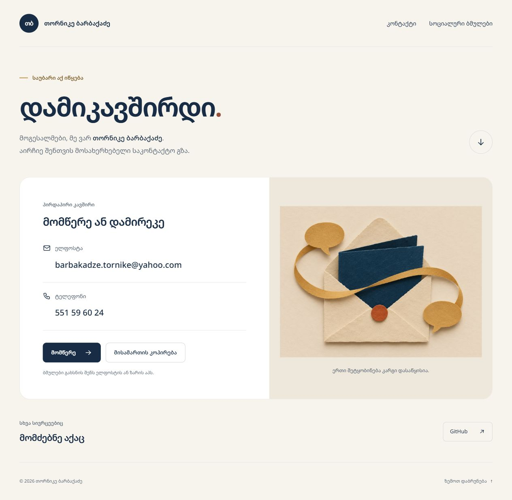

# Exam-AI

ქართული პერსონალური საკონტაქტო გვერდი — AI ხელსაწყოების პრაქტიკული საგამოცდო დავალება.

კოდისთვის გამოყენებულია **Codex და Groq**, გრაფიკისთვის — **ImageGen და Groq-ის SVG გენერაცია**. Prompt-ები და რეალური შედეგები შენახულია პროექტში.

- [გაშვება და პროექტის აღწერა](README.ka.md)
- [საგამოცდო მოთხოვნების შედეგები](docs/requirements.ka.md)
- [გამოყენებული AI ხელსაწყოები](docs/ai-tools.ka.md)
- [ხუთი სქრინშოტი](Screenshots/)
- [მტკიცებულებები და შემოწმებები](evidence/README.ka.md)

